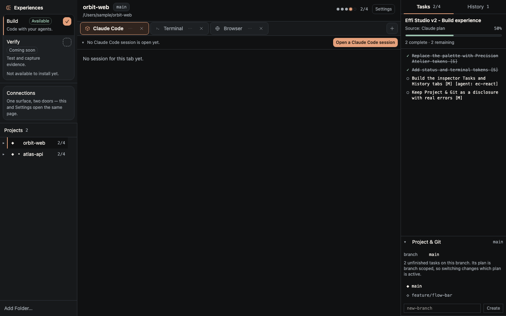
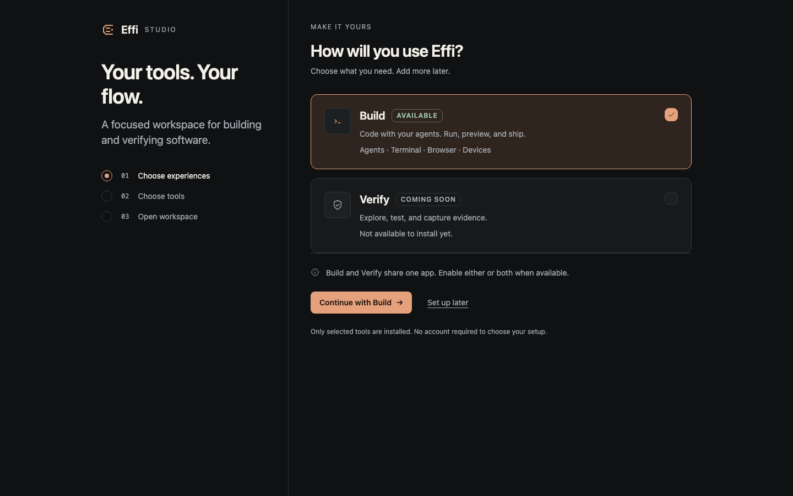
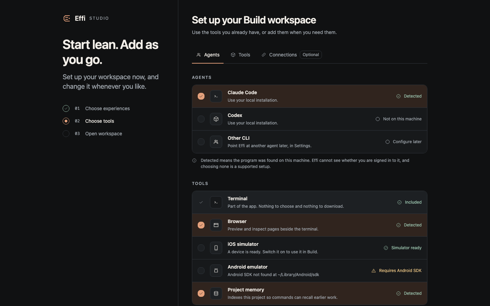
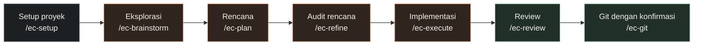
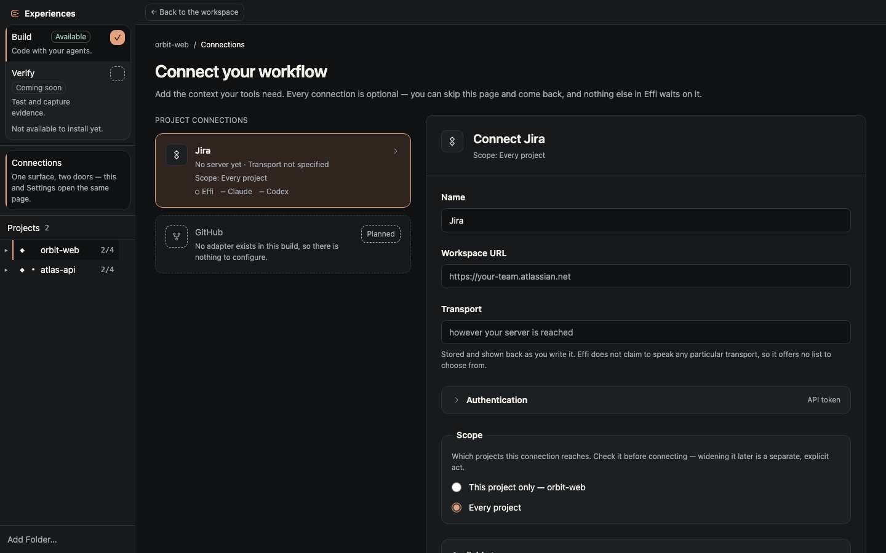
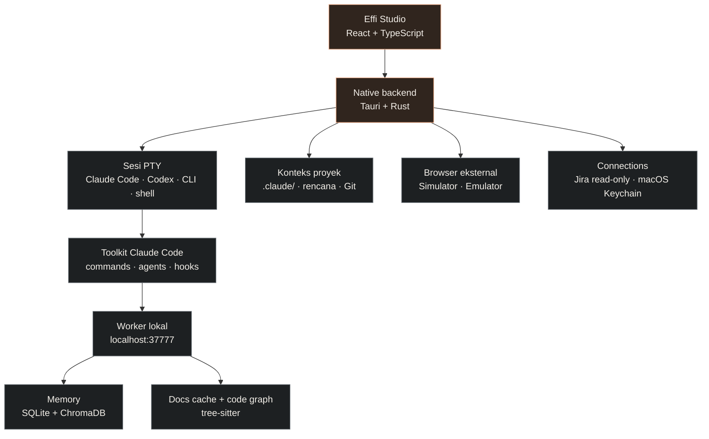

<div align="center">


# Effi Studio

### Satu workspace. Dari ide hingga kode yang terverifikasi.

Kelola proyek, sesi AI agent, terminal, dan progres pekerjaan dalam satu aplikasi desktop.

[](studio/src-tauri/tauri.conf.json)
[](studio/src-tauri/Cargo.toml)
[](studio/package.json)
[](#fitur-dan-status)
[](#fitur-dan-status)

[Mulai](#mulai) · [Workflow](#workflow-dari-ide-ke-commit) · [Pengembangan](#pengembangan-lokal) · [Catatan teknis](studio/README.md)

</div>

<br />



<p align="center"><sub>Preview UI dari production bundle di browser, menggunakan data contoh dan IPC Tauri yang di-stub. Bukan tangkapan aplikasi native atau sesi terminal aktif. <a href="studio/VERIFICATION.md">Detail verifikasi visual →</a></sub></p>

## Kenapa Effi Studio?

Mengerjakan software dengan AI sering berarti berpindah antara terminal, percakapan, rencana, dan konteks proyek. Effi Studio mengumpulkan semuanya dalam satu workbench: pilih proyek, buka agent pilihanmu, lalu lihat pekerjaan yang sedang berjalan beserta riwayatnya.

Di balik aplikasi desktop, toolkit workflow membantu Claude Code membawa sebuah ide melewati keputusan, rencana yang terukur, implementasi, dan review. Konteks proyek, memory, serta dokumentasi library membantu pekerjaan tetap tersambung antar sesi.

| Kebutuhan | Yang disediakan Effi |
|---|---|
| Beberapa proyek sekaligus | Sidebar proyek dengan tab dan sesi per proyek |
| Memilih AI agent | Sesi Claude Code, Codex, atau CLI kustom |
| Mengetahui progres | Inspector Tasks dan History yang membaca rencana Claude |
| Rencana yang bisa diperiksa | Task dengan lokasi file, acceptance criteria, dan langkah verifikasi |
| Konteks lintas sesi | Toolkit memory, dokumentasi library, dan code graph |
| Menghubungkan layanan | Connections dengan cakupan, preview perubahan, dan status per pengguna koneksi |

> **Dua lapisan, satu repositori:** aplikasi **Effi Studio** adalah workbench untuk berbagai CLI. **Toolkit `/ec-*`** adalah workflow khusus Claude Code; kemampuan ini tidak otomatis tersedia pada Codex atau CLI kustom.

## Mulai

### Gunakan aplikasi macOS

1. **[⬇️ Unduh Effi Studio untuk macOS (.dmg)](https://github.com/kaeltech-id/effi-studio/releases/latest/download/EffiStudio-macOS.dmg)** — satu paket universal untuk MacBook Intel maupun Apple Silicon, minimum versi 2.0.0.
2. Buka DMG, lalu pindahkan **Effi Studio** ke **Applications**. Cocokkan dulu checksum-nya dengan nilai di catatan release:

   ```bash
   shasum -a 256 ~/Downloads/EffiStudio-macOS.dmg
   ```

3. Paket ini ditandatangani secara **ad-hoc** dan **belum dinotarisasi Apple**, jadi macOS tidak dapat memverifikasi siapa yang membangunnya. Saat pertama dibuka macOS akan memblokirnya — kadang dengan pesan menyesatkan *"Effi Studio is damaged and can't be opened"*. Itu bukan berkas yang rusak.

   Cara yang dianjurkan, karena keputusannya per aplikasi dan dicatat oleh macOS: coba buka aplikasinya, lalu buka **System Settings → Privacy & Security** dan klik **Open Anyway** pada notifikasi Effi Studio. Pada macOS 15+ jalur klik-kanan → Open sudah tidak berlaku untuk aplikasi ad-hoc.

   > Dengan membuka paksa, kamu menerima bahwa macOS tidak memverifikasi build ini, dan Apple tidak punya cara mencabutnya jika suatu saat ada build yang berbahaya. Notarization belum dikonfigurasi. Alternatif `xattr -dr com.apple.quarantine` juga berhasil, tetapi itu **mematikan pemeriksaan Gatekeeper untuk aplikasi ini secara permanen dan rekursif** — bukan sekadar melepas label — jadi gunakan **Open Anyway** kalau tidak ada alasan khusus.
4. Pilih pengalaman **Build**, lalu pilih komponen yang ingin digunakan. Setup boleh dilewati dan dilanjutkan nanti.
5. Klik **Add Folder…**, pilih proyek, lalu buka tab agent atau terminal.

Target aplikasi desktop saat ini adalah **macOS 11+**. CLI agent dipasang dan diautentikasi secara terpisah; Effi mendeteksi program yang tersedia di komputer, bukan status login akunmu. Agent yang belum terpasang tidak menghalangi aplikasi dibuka.

<details>
<summary><strong>Lihat tampilan setup</strong></summary>





Kedua gambar adalah preview UI dengan data contoh, sama seperti screenshot workbench di atas.

</details>

### Gunakan toolkit di Claude Code

Toolkit dapat digunakan langsung dari terminal, tanpa aplikasi desktop.

```bash
git clone https://github.com/kaeltech-id/effi-studio.git
cd effi-studio
bash install.sh
```

Installer memerlukan **Python 3 dan pip**. Pemeriksaan awal menerima Python 3.8+, tetapi versi Python yang dipakai juga harus memenuhi persyaratan dependency di [`server/requirements.txt`](server/requirements.txt). Rust bersifat opsional untuk membangun `etok`; Node.js diperlukan jika memakai integrasi Figma MCP.

Instalasi penuh menyalin commands dan agents ke `~/.claude/`, memasang worker serta dependency, mendaftarkan hooks Claude Code, mencoba membangun optimizer jika Rust tersedia, dan mengatur daemon pada platform yang didukung. Baca [`install.sh`](install.sh) untuk rincian perubahan.

Untuk memasang komponen tertentu:

```bash
# Hanya definisi workflow dan specialist agents
bash install.sh --only=commands,agents

# Daftar opsi installer
bash install.sh --help
```

Setelah instalasi, buka Claude Code di folder proyekmu dan jalankan:

```text
/ec-setup
```

Perintah ini memetakan stack dan struktur proyek, menyiapkan konteks, serta menginisialisasi memory. Setelah itu, mulai workflow di bawah.

## Workflow: dari ide ke commit



| Perintah | Tujuan | Hasil utama |
|---|---|---|
| [`/ec-setup`](commands/ec-setup.md) | Mengenali proyek dan menyiapkan konteks | `CLAUDE.md`, konfigurasi, dan `.claude/context/` |
| [`/ec-brainstorm`](commands/ec-brainstorm.md) | Membandingkan pendekatan dan menentukan arah | Keputusan di `.claude/decisions/{branch}.md` |
| [`/ec-plan`](commands/ec-plan.md) | Mengubah kebutuhan menjadi task yang konkret | Rencana dengan file, anchor, acceptance criteria, dan verify |
| [`/ec-refine`](commands/ec-refine.md) | Memeriksa baseline dan langkah verify sebelum implementasi | Audit kelayakan rencana |
| [`/ec-execute`](commands/ec-execute.md) | Menjalankan task dalam gelombang paralel beserta verifikasi lokalnya | Implementasi dan bukti per task |
| [`/ec-review`](commands/ec-review.md) | Memeriksa kesesuaian rencana, kualitas, dan dampak perubahan | Review dan perbaikan dalam cakupan rencana |
| [`/ec-git`](commands/ec-git.md) | Menjalankan operasi Git yang diminta pengguna | Operasi Git dengan konfirmasi tersendiri |

**Contoh penggunaan:**

```text
/ec-brainstorm
Tambahkan halaman profil dengan upload avatar.
Bandingkan penyimpanan lokal dan object storage terlebih dahulu.

/ec-plan
/ec-refine
/ec-execute
/ec-review
/ec-git
```

Jalankan bertahap sesuai hasil dan arahan setiap perintah. Setup dilakukan saat menyiapkan proyek; brainstorm berguna saat pilihan pendekatannya perlu dibahas. Commit dan push tetap melalui langkah Git tersendiri.

Ada juga [`/ec-selfhealing`](commands/ec-selfhealing.md) untuk siklus deteksi masalah, perencanaan, perbaikan, dan verifikasi ulang. Perintah ini berdiri sendiri dan hanya dijalankan ketika pengguna memanggilnya langsung.

## Fitur dan status

| Area | Tersedia pada implementasi saat ini | Batasan |
|---|---|---|
| **Build** | Workbench proyek, sesi agent, terminal, Tasks, dan History | Workflow `/ec-*` terhubung ke Claude Code |
| **Agent** | Claude Code, Codex, dan definisi CLI kustom | Dukungan capability berbeda per provider |
| **Browser** | Pengelolaan alamat dan **Open externally** | Halaman dibuka di browser sistem; belum ada browser tertanam |
| **Devices** | Tab dan kontrol iOS Simulator / Android Emulator | Memerlukan tool platform; simulator milik proses luar tidak boleh dihentikan oleh Effi |
| **Connections** | Konfigurasi, cakupan, preview, serta adapter Jira untuk Effi | Jira bersifat read-only; adapter konfigurasi Claude Code/Codex belum tersedia |
| **Custom MCP** | Form konfigurasi terstruktur | Dukungan konfigurasi belum berarti server otomatis diterapkan ke agent |
| **Verify** | Informasi pengalaman yang akan datang | **Coming soon**, belum dapat diaktifkan |
| **GitHub connector** | Entri katalog | **Planned**, belum ada adapter |

Implementasi, pengujian otomatis, dan pengujian native memiliki tingkat bukti yang berbeda. Lihat [catatan teknis Studio](studio/README.md) serta [verifikasi visual](studio/VERIFICATION.md) untuk hasil dan bagian yang belum diuji. Catatan yang tersimpan saat ini belum membuktikan pengoperasian aplikasi native atau build DMG selesai.

<details>
<summary><strong>Lihat halaman Connections</strong></summary>



Preview UI dengan data contoh. Status koneksi Effi, Claude Code, dan Codex dilaporkan secara terpisah; konfigurasi yang terlihat di form bukan bukti bahwa koneksi sudah diterapkan.

</details>

## Arsitektur



- **Desktop:** React 19, TypeScript, Tailwind CSS 4, dan xterm.js; Tauri 2 menangani integrasi native, proses terminal, file watcher, dan tools lokal.
- **Worker:** layanan Python/Flask untuk memory, cache dokumentasi, dan analisis hubungan kode.
- **Token optimizer:** `etok`, binary Rust untuk meringkas output perintah sebelum masuk ke konteks Claude. Hasil kompresi bergantung pada perintah dan outputnya.
- **Penyimpanan:** konfigurasi Studio di `~/.efficlaude/studio.json`; konteks workflow berada di folder `.claude/` proyek. Jalur legacy dipertahankan agar instalasi lama tetap kompatibel.
- **Secrets Connections:** nilai kredensial menggunakan macOS Keychain, bukan metadata Studio. Ini berbeda dari konfigurasi toolkit legacy; jangan membagikan file konfigurasi yang berisi kredensial.

<details>
<summary><strong>Struktur repositori dan konteks proyek</strong></summary>

```text
effi-studio/
├── studio/               # Aplikasi desktop: React + Tauri
│   ├── src/              # UI, tab, workflow, dan panel
│   ├── src-tauri/        # Native backend Rust
│   └── screenshots/      # Preview UI untuk dokumentasi
├── commands/             # Delapan slash commands Claude Code
├── agents/               # Specialist agents per stack dan kebutuhan
├── hooks/                # Hooks workflow dan memory
├── server/               # Memory, docs, dan code graph worker
├── token-optimizer/      # Binary etok
├── design/               # Identitas visual dan referensi mockup
├── tests/                # Pengujian Python dan repository guards
└── install.sh            # Installer toolkit
```

Konteks pada proyek yang menggunakan toolkit:

```text
your-project/
├── CLAUDE.md
└── .claude/
    ├── project-config.json    # Konfigurasi lokal; dapat berisi kredensial
    ├── decisions/
    │   └── {branch}.md        # Keputusan brainstorm per branch
    ├── plans/
    │   ├── {branch}.md        # Rencana workflow per branch
    │   └── archive/           # Riwayat rencana
    └── context/
        ├── stack.md
        ├── structure.md
        └── conventions.md
```

</details>

## Pengembangan lokal

Untuk desktop, siapkan macOS, Xcode Command Line Tools, Rust stable dengan dukungan edition 2024, serta Node.js **20.19+ pada seri 20 atau 22.12+** sesuai engine Vite 8. Dependency agent dan tool device hanya diperlukan untuk fitur yang dipakai.

```bash
# Dari root repositori
cd studio
npm ci
npm run tauri dev
```

Untuk mengerjakan UI saja:

```bash
cd studio
npm run dev
```

Vite menggunakan `http://localhost:1420`. Mode browser biasa tidak menyediakan IPC Tauri; terminal, keychain, dan integrasi native memerlukan aplikasi desktop. Screenshot dokumentasi menggunakan harness dengan IPC stub dan data contoh.

Membangun paket macOS dari folder `studio/`:

```bash
npm run build:dmg
```

Skrip `studio/scripts/build-macos-dmg.sh` menyinkronkan versi dari `VERSION`, membangun paket universal, menyalin hasilnya ke `studio/src-tauri/target/release/bundle/dist/EffiStudio-macOS.dmg`, memverifikasi DMG dapat di-mount, lalu mencetak perintah `gh release create` tanpa menjalankannya. Tanda tangan masih ad-hoc; notarization belum dikonfigurasi.

### Pemeriksaan perubahan

Jalankan pemeriksaan yang relevan dengan bagian yang diubah:

```bash
# UI — dari studio/
npm run build

# Native backend — dari root repositori
cargo test --manifest-path studio/src-tauri/Cargo.toml --lib
cargo check --manifest-path studio/src-tauri/Cargo.toml

# Worker dan repository guards — gunakan virtual environment
python3 -m venv .venv
source .venv/bin/activate
python3 -m pip install -r server/requirements.txt -r requirements-dev.txt
python3 -m pytest

# Token optimizer
cargo test --manifest-path token-optimizer/Cargo.toml
```

### Diagnostik worker

Setelah toolkit terpasang:

```bash
curl http://localhost:37777/health
bash ~/.efficlaude/server/start.sh
bash ~/.efficlaude/server/stop.sh
```

| Kendala | Yang perlu diperiksa |
|---|---|
| Agent berstatus `needsAttention` | Pastikan CLI terpasang; periksa path executable di pengaturan agent |
| Tasks belum muncul | Pastikan proyek memiliki rencana Claude yang dapat dibaca; jalankan `/ec-setup` lalu `/ec-plan` |
| Browser tidak merender halaman di tab | Gunakan **Open externally**; tab saat ini adalah pengelola alamat |
| Device tool tidak tersedia | Periksa Xcode/iOS Simulator atau Android SDK dan emulator |
| Worker tidak merespons | Jalankan `start.sh`, lalu periksa kembali endpoint `/health` |

## Kontribusi

Laporkan bug dan usulkan fitur melalui [Issues](https://github.com/kaeltech-id/effi-studio/issues), atau kirim pull request dengan penjelasan perubahan dan pemeriksaan yang sudah dijalankan. Untuk perubahan UI, sertakan screenshot dan sebutkan apakah berasal dari aplikasi native atau preview dengan data contoh.

Referensi untuk kontributor: [implementasi dan batasan Studio](studio/README.md), [verifikasi tampilan](studio/VERIFICATION.md), serta [design package](design/effi-studio-v2/README.md).

---

<p align="center">Dikembangkan oleh <a href="https://github.com/kaeltech-id">kaeltech-id</a> · Effi Studio</p>
