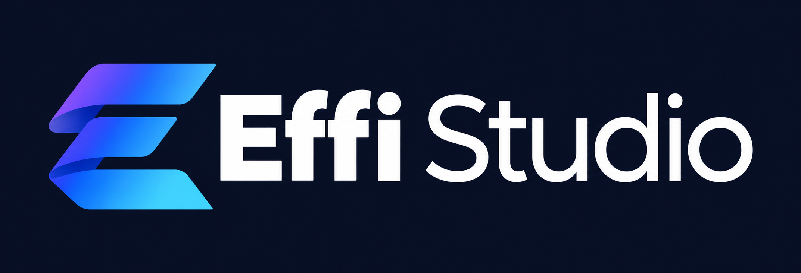

# Effi Studio — Rebrand

Konsep identitas baru: monogram **E** dari pita yang mengalir, menggambarkan workflow yang tersambung. Palet dingin memadukan ungu, biru, biru muda, dan putih di atas navy.

## Aset

## Revisi workbench

[Workbench v2 — conversation first](WORKBENCH-V2.md) memperbarui percakapan AI, navigasi folder di kiri, serta task dan history di kanan. Mockup baru tersimpan terpisah di [01-build-workbench-v2.png](mockups/01-build-workbench-v2.png).

### Identitas brand

| File | Penggunaan |
|---|---|
| `effi-studio-logo-transparent.png` | Logo PNG transparan dengan wordmark biru muda, untuk ditempatkan di latar gelap |
| `effi-studio-logo-navy.png` | Logo lengkap dengan latar navy, untuk presentasi dan materi brand |
| `effi-studio-mark-transparent.png` | Simbol E tanpa tulisan, PNG transparan |

## Palet acuan

| Warna | Hex |
|---|---|
| Navy | `#080F24` |
| Ungu | `#8B5CF6` |
| Biru | `#4263EB` |
| Biru muda | `#76CFFF` |
| Putih | `#F5F8FF` |

Warna di atas merupakan acuan prompt; hasil raster dapat mengandung variasi gradasi.

## Penggunaan

- Tempatkan versi transparan di latar navy atau gelap agar tulisan biru muda terbaca. Versi navy menggunakan wordmark putih.
- Pertahankan rasio gambar dan ruang kosong di sekeliling logo.
- Gunakan file navy jika membutuhkan latar yang sudah menyatu dengan gambar.
- Aset ini merupakan PNG raster hasil generasi, bukan master vektor.
- Versi transparan memiliki alpha nyata, tetapi hasil generasi masih memperlihatkan artefak kecil di sekitar tepi. Versi navy merupakan preview identitas yang lebih bersih; penyempurnaan master diperlukan untuk pemakaian produksi pada ukuran besar.

Logo dibuat dengan built-in image generation. Prompt dan instruksi refinement tersimpan di `prompts.md`. Aset aplikasi sebelumnya tetap berada di lokasi asal; rebrand ini disimpan terpisah untuk ditinjau.
